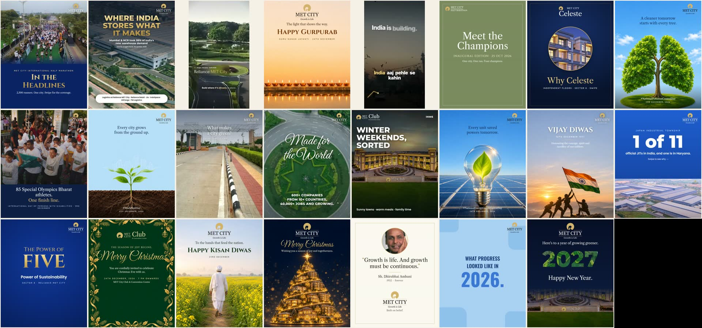
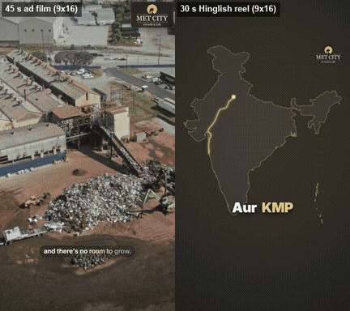

# Custom-Skills-By-Ashish
Custom Claude Code skills built by Ashish Gupta.

To install one, copy its folder into `~/.claude/skills/` (Windows: `%USERPROFILE%\.claude\skills\`). It loads automatically when a request matches its description.

| Skill | What it does |
|---|---|
| [website-strategy](website-strategy/) | Plans and builds marketing and landing pages from references and real content, with approval before code. |
| [motion-video-from-reference](motion-video-from-reference/) | Premium motion-graphics videos (launch films, promos, ads, reels) that follow a reference video beat for beat, built in code, with sound design, voice-over and an MP4 render. |
| [brand-social-studio](brand-social-studio/) | A month of social posts and videos for any brand, made to look like the brand made them: a deep study of its own Instagram, real formats copied, real photos and logo, Codex concept art, HTML-set text, and a full-screen presenter. |

---

## motion-video-from-reference

Videos made with this skill: SUPA launch film, SUPA promo, SUPA on WhatsApp, SUPA for everyone, a Reliance MET City 45 s ad and a MET City Hinglish reel.

## brand-social-studio

**Posts:** a 20 Nov – 31 Dec 2026 calendar for Reliance MET City. It has 23 posts: 13 image posts and 8 carousels (55 slides) plus 2 films. Each post is modelled on a real @reliance_met post of the same format.

Every slide, caption and the reference post each one copies are in [examples/posts-showcase.html](brand-social-studio/examples/posts-showcase.html). Download it with its `posts/` folder and open it in a browser.

**Videos:** the two MET City films (9:16): a 45 s industrial ad film and a 30 s Hinglish growth reel.

> The MET City work is spec work made for a pitch. The brand did not publish it. Photography and footage are the brand's own and were used for that pitch.
